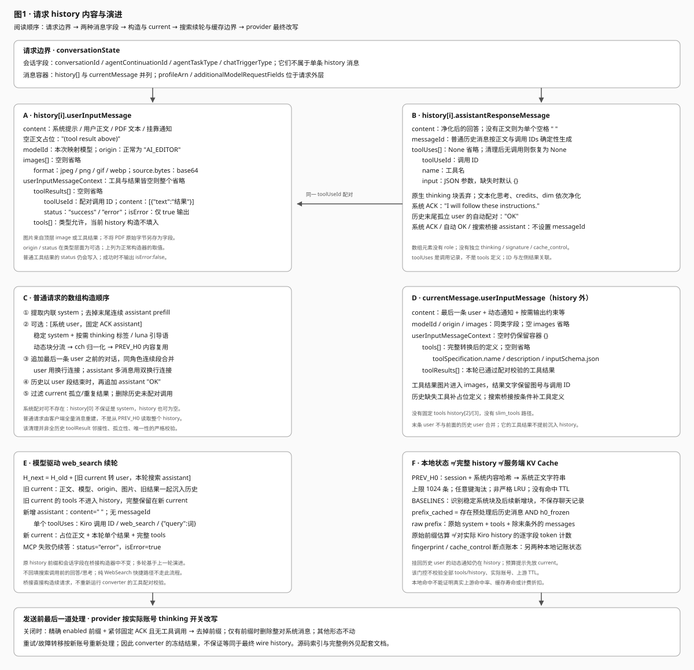
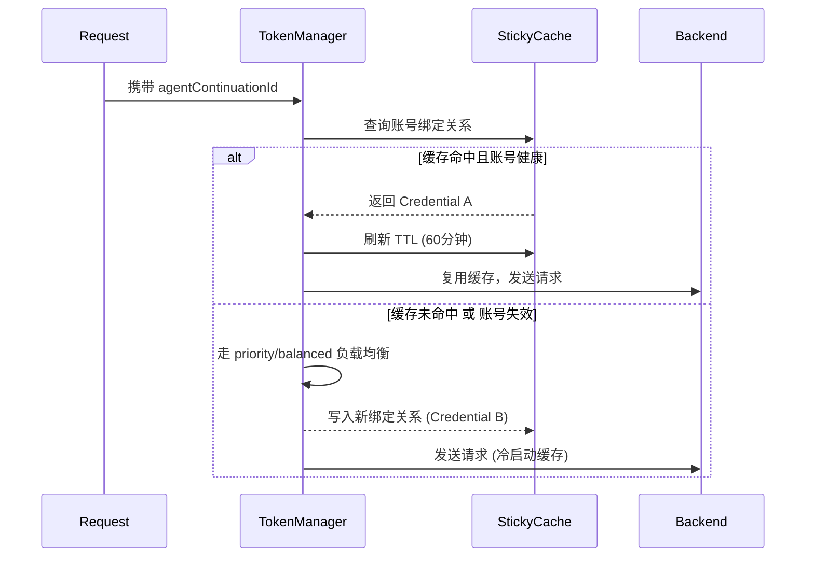

# Kiro 缓存与状态管理全景解析

本文档集中梳理了 `kiro2cc-proxy` 中与 Kiro API 缓存、会话路由以及底层状态管理相关的所有机制和技术实现细节。在反向代理中，**缓存是降低 API 成本和提高响应速度的绝对核心**。

图表查看方式：支持 SVG 的 Markdown 预览器可直接显示；不支持时，打开 [图1·请求 history 内容与演进](diagrams/01-kiro-history.svg)。

本文本次仅按当前源码核对第 1、2 节中的请求结构与前缀稳定机制。第 1 节保留的历史计费实测，以及第 3–6 节的路由、计费、usage 和性能描述，未随本次重新验证；不得将其视为当前版本已确认的上游契约。

---

## 目录
1. [Prompt Caching（前缀缓存）机制](#1-prompt-caching前缀缓存机制)
   - [请求 history 的完整内容与演进](#13-请求-history-的完整内容与演进)
2. [跨轮次前缀稳定（系统基线与 PREV_H0）](#2-跨轮次前缀稳定系统基线与-prev_h0)
3. [会话粘性路由（Sticky Cache）](#3-会话粘性路由sticky-cache)
4. [缓存命中验证与 Token 反推](#4-缓存命中验证与-token-反推)
5. [底层性能优化实现（O(1) 淘汰与异步写）](#5-底层性能优化实现o1-淘汰与异步写)
6. [Usage 终值合成（四层降级链 + ephemeral 拆分）](#6-usage-终值合成四层降级链--ephemeral-拆分)

---

## 1. Prompt Caching（前缀缓存）机制

**源码可确认的机制**：代理通过稳定会话标识、系统内容和历史消息来提高上游前缀复用的机会；但请求中的 `history` 不等于服务端 KV Cache，本地复用或估算也不能证明上游真实命中。下节的折扣和命中率属于历史实测记录，不是仅凭本仓库即可确认的上游保证。

### 1.1 计费模型与缓存折扣（重要）
**结论**：Kiro 具有跨会话生效的前缀缓存机制，缓存命中部分按全价 50% 计费（代理实测 2026-06-20 确认，不同于 Anthropic 的 10%）。

- `meteringEvent` 可携带缓存用量字段（`src/kiro/model/events/metering.rs::MeteringEvent`）；本次只说明请求内容与本地前缀估算的边界，不重新核验缺失字段时的完整 usage 决策链。第 4、6 节保留的历史说明不作为本节依据。
- **缓存前缀含 system + tools**：Kiro 将 current_message 中的 tools 定义也纳入缓存前缀，后续 turn 命中率达 89-97%。
- 保持 `agentContinuationId`、稳定系统配对及历史对话，并保持当前消息中的工具定义稳定，是代理促进前缀复用的手段；当前实现没有固定的工具定义 `history[2]`。
- 降低 credits 消耗的手段：① 稳定前缀以提高缓存命中率（冻结 system prompt、tools 定义）；② 缩短非缓存部分（新增对话消息）。

**上下文窗口映射**：`context_window_for_model()`（`src/anthropic/stream.rs:548`）已统一对所有模型返回 **1,000,000**，不再按模型分档。

**参考费率（k_ref = credits per $1 USD，`src/model/usage.rs::get_k_ref`）**：
| 模型 | k_ref | input_price ($/M) | cache_read 折扣 |
|------|-------|-------------------|----------------|
| sonnet 系列 / sonnet-5 / haiku（默认档） | 1.43 | $3.0 | 50% 全价 |
| opus-4.5 / opus-4.6 | 1.90 | $15.0 | 50% 全价 |
| opus-4.7 / opus-4.8 / opus-5（及未知 opus/fable 兜底） | 2.36 | $15.0 | 50% 全价 |

### 1.2 核心标识符：`agentContinuationId`
代理稳定派生 `agentContinuationId`，并将其用于会话连续性和粘性路由。源码不能证明它是 Kiro 缓存命中的“唯一凭证”，也不能保证该字段变化就使所有服务端前缀缓存失效。

代理层针对不同客户端的派生逻辑：
1. **标准 Claude Code 客户端**：Claude Code 会在请求中附带 `metadata.user_id`（如 `user_xxx_account__session_0b4445...`）。代理提取出 `session_UUID` 作为 `conversationId`。
2. **第三方客户端（Fallback 降级机制）**：对于无 `metadata` 的客户端（如 Cursor、Zed、Open WebUI），若按默认生成随机 UUID，会导致每一轮都是新会话。因此引入了 Fallback 逻辑：
   - 将**截断的 System Prompt + 排序后的工具名列表 + 首条原始消息的 role 与顶层文本**进行 `SHA-256` 计算；system 和首条消息文本分别最多取 4096 字符，图片 base64 不作为首条文本 seed。
   - 由此派生稳定的 UUID；这些 seed 不变时标识稳定，但不等于上游一定命中缓存（`src/anthropic/converter/session.rs::derive_fallback_conversation_id`）。
3. **最终格式化**：`agentContinuationId` 由 `SHA-256("agent-continuation:" + conversationId)` 格式化得出，确保即使同一会话也能对外部保持哈希安全性。

### 1.3 请求 history 的完整内容与演进

**先明确存储对象**：这里讨论每次上游请求中的 `conversationState.history` 数组，不是代理持久化的聊天记录，也不是 Kiro 服务端的 KV Cache。普通请求由客户端回传的消息重新构造；搜索桥接则在同一次请求的内部续轮中追加历史。



#### 1.3.1 数组位置与条目形状

请求的 `conversationState` 包含 `conversationId`、`agentContinuationId`、`agentTaskType`、`chatTriggerType`、`history` 和 `currentMessage`。会话字段不是每条 history 消息的字段；请求级 `profileArn`、`additionalModelRequestFields` 也在 history 外。

数组元素只有 `userInputMessage` 或 `assistantResponseMessage` 两种外层对象，**没有 `role` 字段**。下表路径均相对单个 `history[i]`。

| 字段路径 | 实际保存内容与省略规则 |
|---|---|
| `userInputMessage.content` | 必有字符串：系统提示、用户文本、提取的 PDF 文本、就地挂回的通知，或空正文占位 `"(tool result above)"` |
| `userInputMessage.modelId` | 必有字符串；普通转换使用本次映射后的 Kiro 模型 ID |
| `userInputMessage.origin` | 类型允许省略；正常构造为 `"AI_EDITOR"` |
| `userInputMessage.images[]` | 空数组省略；图片包括顶层图片与从 tool_result 提升的图片 |
| `images[].format` / `images[].source.bytes` | 格式为 `jpeg/png/gif/webp`；`bytes` 是 base64 字符串，不是本地文件路径 |
| `userInputMessage.userInputMessageContext` | `tools` 和 `toolResults` 都为空时整个省略 |
| `userInputMessageContext.toolResults[]` | 空数组省略；保存工具执行结果，不是工具定义 |
| `toolResults[].toolUseId` | 对应 assistant 工具调用的 ID |
| `toolResults[].content` | 当前构造器写成 `[{"text":"结果文本"}]`；模型类型本身允许对象数组 |
| `toolResults[].status` / `toolResults[].isError` | 构造器写 `"success"` 或 `"error"`；`isError=false` 省略，失败时写 `true`；类型层面 `status=None` 也省略 |
| `userInputMessageContext.tools[]` | 类型允许存在，但普通 history 构造不填入，搜索续请求也明确移除；完整工具定义保留在 current |
| `assistantResponseMessage.content` | 必有字符串：净化后的回答、固定 ACK、自动 `"OK"`，或单个空格 `" "` |
| `assistantResponseMessage.messageId` | 普通历史 assistant 生成确定性 ID；系统 ACK、自动 `"OK"`、桥接追加 assistant 不设置，序列化时省略 |
| `assistantResponseMessage.toolUses[]` | 普通构造在有调用时写入；`None` 省略，孤立调用删空后恢复为 `None` |
| `toolUses[].toolUseId` / `.name` / `.input` | 调用 ID、工具名、原始 JSON 参数；缺失 input 时默认 `{}` |

源码依据：`src/kiro/model/requests/conversation.rs:93–347`、`src/kiro/model/requests/tool.rs:11–142`。`Message` 为 untagged enum；converter 组装时 history 为空则省略该字段。provider 后续删除系统配对时，可能留下已有的 `history: []`。

#### 1.3.2 数组顺序不是固定四条前缀

1. **预处理原始 messages**：提取内联 `role:"system"` 文本；跳过内联 `tool_addition/tool_removal` 事件；校验不支持的角色与非法 system 内容；移除末尾所有连续 assistant prefill。处理后没有 user 可作为当前消息则报错。
2. **可选系统配对**：存在可发送的系统内容时，先写系统 user，再写 `{"assistantResponseMessage":{"content":"I will follow these instructions."}}`。若没有系统配对，`history[0]` 可以是普通历史消息，甚至整个 history 不存在。
3. **普通历史**：只转换预处理 messages 中最后一条 user 之前的部分。连续 user 合并；连续 assistant 合并。历史末尾若剩余 user 段，再补 `{"assistantResponseMessage":{"content":"OK"}}`。
4. **当前消息独立**：最后一条 user 放入 `currentMessage`，不与前面的历史 user 合并。完整 tools、当前工具结果和当前图片随它发送。
5. **配对清理**：过滤 current 的孤立／重复 toolResult；删除历史中尚无结果配对的 toolUse。被过滤结果携带的图片一并移除，并重建剩余图片编号。此逻辑不是对全部历史结果的邻接、孤立和重复情况做严格校验。
6. **发送前再处理**：provider 按实际账号 thinking 开关调整请求，最终 wire history 可能与 converter 产物不同，详见 §2.4。

源码依据：`src/anthropic/converter/convert.rs:44–127,198–318`、`history.rs:292–343`、`tools.rs::validate_tool_pairing/remove_orphaned_tool_uses`。

#### 1.3.3 正文、图片、工具与思考分别放在哪里

- **用户正文**：同一消息的非空 text 块以 `\n` 连接；连续历史 user 的正文再以 `\n` 连接，图片和 toolResults 按顺序拼接。PDF 尝试提取为 `<document media_type="application/pdf">…</document>` 文本；提取失败写提示文字，不把 PDF 原始字节作为 history 的独立字段。
- **工具结果图片**：移动到同条 user 的 `images[]`，结果文字留下 `[Image n attached from tool_result ID]`。序号从 1 开始，覆盖合并后整条 user 的图片列表；不能转发的工具图片留下 `[Image omitted ...]` 提示。
- **助手正文**：单条 assistant 的 text 块直接拼接，连续多条 assistant 的有效正文以 `\n\n` 连接。先剥文本化思考，再剥 credits 尾注，最后剥 dim 样式；完整文本化思考被删除，流中断等缺少结束标记的情况按清理函数降级处理。
- **助手工具调用**：`tool_use` 转为 `toolUses`，与正文并列；不是把工具参数写进 content，也不是把工具定义写入 history。
- **原生思考块**：assistant 的 `thinking` 块整块丢弃；没有独立的 thinking/signature 字段。系统 user 中可能出现的 thinking 控制标签是提示词文本，与历史思考内容不是一回事。
- **消息 ID**：普通 assistant 的 seed 为 `"assistant-msg:" + 最终正文 + 每个 ":" + toolUseId`，SHA-256 前 16 字节格式化为 UUID 形状。工具名和 input 不直接参与该 seed；后续删除孤立 toolUse 不重算 messageId。
- **当前工具定义**：转换后的完整定义位于 `currentMessage.userInputMessage.userInputMessageContext.tools[].toolSpecification.{name,description,inputSchema.json}`；必要时包含搜索桥接定义和历史缺失工具的占位定义。当前没有 `slim_tools` 或固定的 tools history 配对。
- **额外当前提示**：近期知识提示、输出 JSON Schema 约束追加在 current 正文；分流且无历史锚点的系统通知放在 current 开头。原始 `cache_control` 不是 Kiro history 的独立字段。

源码依据：`src/anthropic/converter/message.rs:22–190`、`history.rs:365–585`、`convert.rs:155–195,211–305`。

#### 1.3.4 普通工具往返的序列化示例

以下只展示一次工具结果已进入历史后的请求片段，示例 ID／文本不是实际会话数据。省略请求级字段；`messageId` 的示例值用说明文字代替。

```json
{
  "conversationState": {
    "history": [
      {"userInputMessage": {"content": "稳定系统提示", "modelId": "模型ID", "origin": "AI_EDITOR"}},
      {"assistantResponseMessage": {"content": "I will follow these instructions."}},
      {"userInputMessage": {"content": "读取示例文件", "modelId": "模型ID", "origin": "AI_EDITOR"}},
      {"assistantResponseMessage": {
        "messageId": "由正文和调用ID派生",
        "content": " ",
        "toolUses": [{"toolUseId": "call_1", "name": "Read", "input": {"path": "example.txt"}}]
      }},
      {"userInputMessage": {
        "content": "(tool result above)", "modelId": "模型ID", "origin": "AI_EDITOR",
        "userInputMessageContext": {
          "toolResults": [{"toolUseId": "call_1", "content": [{"text": "文件正文"}], "status": "success"}]
        }
      }},
      {"assistantResponseMessage": {"messageId": "由回答正文派生", "content": "已读取示例文件。"}}
    ],
    "currentMessage": {
      "userInputMessage": {
        "content": "请继续分析", "modelId": "模型ID", "origin": "AI_EDITOR",
        "userInputMessageContext": {
          "tools": [{"toolSpecification": {
            "name": "Read", "description": "读取文件",
            "inputSchema": {"json": {"type": "object", "properties": {"path": {"type": "string"}}}}
          }}]
        }
      }
    }
  }
}
```

注意：成功结果没有 `isError`；无图片则没有 `images`；无上下文的历史 user 没有 `userInputMessageContext`，但 current 的该容器即便为空仍会序列化。

#### 1.3.5 web_search 桥接续请求

桥接每轮使用上一轮演进状态，执行 `H_next = H_old + [旧 current 转历史 user, 本轮搜索 assistant]`；**旧 H 原有条目不在桥接构造器中改写**。

- **旧 current 沉入 history**：保留 content、modelId、origin、images、旧 toolResults；明确不带 tools。
- **新增 assistant**：content 为 `" "`；仅一个 `toolUses`，内容为 `{toolUseId: Kiro调用ID, name:"web_search", input:{query: 搜索词}}`；不设置 messageId，不回填调用前已输出的正文／thinking。
- **新 current**：content 为 `"(tool result above)"`；toolResults 仅本轮一个结果；完整 tools 保留，旧图片已经移入 history。结果 ID 使用 Kiro 调用 ID，不是 MCP 另生成的 ID。
- **失败结果**：MCP 搜索失败写 `status:"error", isError:true`，仍发续请求让模型处理失败。
- **不变字段**：conversationId、agentContinuationId、agentTaskType、chatTriggerType 及请求级参数沿用；但发送时仍经过 provider 的账号级调整。
- **适用范围**：这是模型驱动搜索桥接的内部续轮；纯 WebSearch 快捷路径不经过普通 converter history 构造。下一次客户端 HTTP 请求重新走普通转换，不等于自动复用此内部数组。

源码依据：`src/anthropic/handlers/bridge.rs:314–411`、`src/anthropic/handlers/post_messages.rs:105–124`。

---

## 2. 跨轮次前缀稳定（系统基线与 PREV_H0）

### 2.1 系统 user 的内容组成与条件

系统候选块来自顶层 system、内联 system 文本，以及配置允许时追加的 Write/Edit/MultiEdit 分块写入提示。识别并分流动态块后，稳定块按 `\n` 拼接。

| 条件 | 系统 user / ACK 的构造 |
|---|---|
| 存在非空稳定系统内容 | 按需前置 thinking 控制标签、追加 luna 引导语，规范化 cch，经过 PREV_H0，再写 user + 固定 ACK |
| 无系统分支，存在 enabled thinking 前缀 | 单独以前缀作 user.content，再写固定 ACK |
| 存在 luna 反伪标签引导语且没有系统正文 | 以引导语作 user.content，再写固定 ACK |
| 无上述内容 | 不插入系统配对 |

注意：显式空 system 与真正无 system 的分支不完全相同；`system_present=true` 且正文为空时，不走“单独 thinking 前缀”分支。全部系统块被分流时则按无系统分支处理。

控制前缀精确形态为 `<thinking_mode>enabled</thinking_mode><max_thinking_length>N</max_thinking_length>`。非 luna 模型且请求 thinking.type 为 enabled 时可生成；稳定正文已包含控制标签则不重复注入；adaptive 不注入此文本前缀。luna 仅在请求启用 thinking 时生成反伪标签引导语。

源码依据：`src/anthropic/converter/history.rs:137–290`、`thinking.rs:85–145`。

### 2.2 动态内容分流，不是无条件冻结所有元数据

1. **已知动态块**：识别 UserPromptSubmit/PreToolUse/PostToolUse/Stop hook、deferred tools、MCP connecting、任务工具提醒，以及单独的 `<total_tokens>…</total_tokens>` 块；SessionStart 不在 hook 动态名单中。
2. **系统基线**：当前稳定块包含已有完整基线，且新增字节数不超过基线字节数时，将新增块分流；多个匹配取最大的基线。无匹配则登记新基线，不永久复用旧提示。
3. **通知位置**：有锚点的非空、非预算动态块，包进 `<system-reminder>` 后挂回相邻历史或当前 user 的前／后；优先紧随其后的 user，否则前一 user，再向后／向前寻找。顶层动态块、无锚点块、预算提示走 current 开头路径。
4. **真实缓存边界**：就地挂回历史的通知仍属于 history 内容；只是从系统前缀分离，并非“所有动态内容永远不参与任何前缀”。预算提示保留在 current 开头，但桥接续轮会把旧 current 沉入 history。
5. **cch 规范化**：使用字符串查找替换第一个 `cch=` 后至分号／换行／末尾之间的值为 `0`；不是正则，不会顺便冻结 `cc_version`、gitStatus 或 currentDate。

源码依据：`src/anthropic/converter/prompt.rs:6–87`、`baseline.rs:117–170`、`history.rs:142–196`、`convert.rs::resolve_inline_anchor`。

### 2.3 PREV_H0 存什么，以及不存什么

- **键**：`session_id#SHA-256(规范化后的完整系统内容)[..16]`，这里取十六进制哈希字符串前 16 字符。
- **值**：系统 user 的 content 字符串与 last_used；不存整个 history、图片、工具调用、工具结果或 tools。
- **复用**：命中时复用相同内容；内容变化产生新键并重新登记。该状态在构造阶段更新，不代表上游已成功接收。
- **容量**：最多 1024 个条目，不等于 1024 个会话。超限用 `HashMap::keys().next()` 选键删除；虽然更新 last_used，但这里不按它排序，**不是严格 LRU，也没有命中时的 TTL 校验**。
- **工具**：没有 PREV_TOOLS 冻结表；完整 tools 每轮转换到 current context。工具变化仍可能影响上游前缀复用，不能从 history 不变推出整个请求前缀不变。

源码依据：`src/anthropic/converter/history.rs:220–258`、`cache.rs:8–35`、`convert.rs:259–285`。

### 2.4 provider 的最后一次改写

账号关闭 thinking 时，provider 除移除原生 thinking 字段外，还检查 history 首条是否为精确的 enabled 控制前缀，第二条是否为固定 ACK 且无工具调用。匹配后，若还有系统正文则只去前缀；若仅剩前缀则删除整对消息。其他位置和不匹配形态不动。

因此，converter 的 `history[0]` 冻结并不意味着最终发送的首条绝不会变化；故障转移到不同开关配置的账号时，会按新账号重新处理。

源码依据：`src/kiro/provider/errors.rs:170–298`、`src/kiro/provider/retry.rs:177–207`。

### 2.5 history 与本地 cache_read 估算不是同一份数据

本地 `prefix_cached = 预处理后存在历史消息 && h0_frozen`。只有非空稳定系统内容经过 PREV_H0 时，h0_frozen 才取实际查表结果；其他分支保持 true。它没有逐字节检查全部 history、tools，也没有检查实际账号或上游 TTL。

本地 raw prefix 使用**原始请求的 system + tools + 除最后一条原始消息外的 messages**估算，再由 prefix_cached 门控为原值或 0；不是对 Kiro 序列化 history 数组计数。内联 system 分流、assistant prefill 裁剪、图片转换、工具清理和注入提示都可能使两份内容不同。

注意：PREV_H0 内容复用、系统基线、账号级 fingerprint 和 cache_control 断点模拟账本是不同状态；后两者也不等于服务端 KV Cache。本节不据此承诺真实命中率、TTL 或折扣。

源码依据：`src/anthropic/converter/history.rs:338–362`、`src/anthropic/handlers/helpers.rs:372–392`、`src/cache/breakpoint.rs`、`src/cache/fingerprint.rs`。

---

## 3. 会话粘性路由（Sticky Cache）

**核心矛盾**：`kiro2cc-proxy` 支持多 Kiro 账号（Credential）轮询与故障转移。但是，Kiro 的 Prompt Cache 是在物理层面**按账号隔离**的。如果一个会话第一轮请求落在账号 A，第二轮被负载均衡分配到账号 B，那么该会话的前缀缓存将彻底作废，导致 Token 成本暴增。

### 3.1 粘性路由流转机制
为解决此问题，代理实现了基于 `agentContinuationId` 的 Sticky Cache 路由机制。



### 3.2 埋点指标与跨账号预热
- **无锁指标监控**：在路由过程中，代理利用 `AtomicU64` 精准打点 `sticky_hits` 和 `sticky_misses`，并通过 `/api/admin/rpm` 接口实时暴露，供管理员监控粘性路由健康度。
- **缓存隔离预热**：两个不同的 credential 各自被选中并预热后，缓存各自在 Kiro 服务端独立保留。中途若因 `429 限流` 等不可抗力被逼轮换，切回原账号后将直接命中缓存，无需重新预热。

---

## 4. 缓存命中验证与 Token 反推

AWS Q / Kiro 的流式响应中，`meteringEvent` 不直接返回 `cache_read_input_tokens` 字段，但缓存折扣体现在 `usage` credits 数值中。代理层通过数学反推，从实际扣费中精确还原缓存命中量。

### 4.1 `effective_rate`（有效费率标定）
代理在日志中记录了去噪后的有效费率：
`effective_rate = metering_credits / (input_tokens + 5 × output_tokens) × 1000`
*(注：公式中的 `5` 是消除 Output token 价格比差异的乘数)*

- **首轮（跨会话缓存命中 system+tools）**：sonnet-4.6 约 `0.0044`（已享受 ~88% 缓存折扣）
- **后续 turn（高缓存命中）**：降至 `0.0022-0.0025`（~97-99% 命中率）
- **理论无缓存全价 (sonnet)**：`k_ref × input_price / 1M = 1.43 × 3.0 / 1,000,000 = 0.00000429` credits/token
- **理论无缓存全价 (opus-4.7/4.8/opus-5)**：`k_ref × input_price / 1M = 2.36 × 15.0 / 1,000,000 = 0.0000354` credits/token

### 4.2 cache_read 派生：前缀字符估算（`token::count_prefix_tokens`）
> 替换时间：2026-06-25。旧的 `infer_cache_read_tokens(credits 反推)` 已废弃 ——
> 反推路径在大请求上会因 `baseline - input_credits` 接近 0 或单价跌破 50% 折扣价被
> clamp 触顶（恒显示 100% 命中），掩盖真实命中梯度。

新算法直接按 Anthropic prompt cache 协议语义估算：

```
new_input  = estimate(messages.last())                       # 当前 user turn
cache_read = estimate(system) + estimate(tools) + Σ estimate(messages[0..n-1])
total      = cache_read + new_input
cache_creation = 0                                           # 简化，不再模拟
```

要点：
- **tools 永远不计入 new_input**：跨请求基本稳定，恒视为前缀（即使首条请求 messages.len()==1 也只把 system+tools 计入 cache_read，messages[0] 计入 new_input）
- **估算口径**：与 `count_all_tokens_local` 完全一致（四分类加权 `count_tokens`），保证 `prefix.min(input_total)` 不溢出
- **优先级**：在 `select_final_usage` 四层降级链中替代了原 credits 反推位（第 2 层），仍排在 metering 真值（第 1 层）之后

**与 Anthropic 协议的偏差**：
- Anthropic 真值由服务端 token tokenizer 算出，这里是本地字符估算，差异 ±15-30%
- Kiro 内部前缀缓存按 hash 分块，理论命中可能小于消息边界；估算只能给出"理论上界"

精度与平均值上展示的"反推"接近，但永不再 clamp 至 100%。

历史日志中的 `effective_rate` / `credits_per_ktok` 仍由 metering credits 计算，保留作为账单核对参考。

---

## 5. 底层性能优化实现（O(1) 淘汰与异步写）

为保障缓存操作与统计追踪在高并发下不会成为系统瓶颈，底层实施了核心重构（阶段 1 P0 级优化）：

### 5.1 RPM 监控：无锁环形桶 (Ring Buffer)
- **旧方案缺陷**：使用 `Vec<Instant>` 无脑追加请求时间戳，仅在调用后台 API 时才执行 `.retain()` 剔除过期数据。长期运行会导致 OOM 和数组扫描的高昂 CPU 开销。
- **重构方案**：采用定长环形数组 `[Bucket; 60]`（对应 60 秒时间窗）。
  ```rust
  let index = (now_secs as usize) % 60;
  // 直接覆盖或累加对应秒数的槽位，实现 O(1) 复杂度的更新与统计
  ```
- **收益**：天然支持滑动时间窗的数据过期与覆盖，内存消耗永远恒定，彻底消除了 OOM 隐患。

### 5.2 统计落盘：异步 MPSC 与防抖写 (Write-Behind)
- **旧方案缺陷**：对涉及磁盘写操作的 `UsageTracker`、`ThrottleLog` 和 `FailureLog`，每次请求结束都在 HTTP 处理线程同步调用 `fs::write`，当磁盘 IO 抖动时直接卡死 Tokio Worker。
- **重构方案**：
  - 引入 `tokio::sync::mpsc::unbounded_channel` 以无锁方式传递日志事件脏信号。
  - 后台衍生出专门的 `tokio::spawn` 异步任务，设定每 5 秒定期利用 `spawn_blocking` 进行批量防抖写盘（Debounce）。
  - **Graceful Shutdown**：接管应用退出信号，确保进程被关闭时，后台通道能被清空并执行最后一次强制落盘，确保财务级计费数据的绝对安全。

---

## 6. Usage 终值合成（四层降级链 + ephemeral 拆分）

> 引入时间：v2.6.12（2026-06-24）
> 关联模块：`src/cache/mod.rs::select_final_usage` · `src/cache/simulation.rs::{scale_to, clamp_to_total}` · `src/anthropic/handlers.rs`

回包给客户端的 `usage` 字段并非由单一来源直接产出，而是经过一条**四层降级链**统一裁决，并由 `clamp_to_total` 保证多个 token 字段之间的算术不变性。该模块由 `select_final_usage` 纯函数承担，便于单元测试覆盖所有分支。

### 6.1 四层降级链优先级

| 层级 | 信号来源 | 触发条件 | 数据特征 |
|------|---------|----------|---------|
| ① metering 真值 | `meteringEvent.cache_read` / `cache_creation` | Kiro 上游直接返回 metering 字段 | 最权威；Kiro 不区分 5m/1h，默认全部归为 5m |
| ② prefix 估算 | `token::count_prefix_tokens` 的结果 | metering 缺失但可估算 system+tools+history[0..n-1] | 调用方在 `handlers.rs` 中**预先估算**后再传入；本层仅消费已估算的 `cache_read`（饱和裁剪到 `final_input_tokens`），`cache_creation`/`cache_creation_5m`/`cache_creation_1h` 全部置 0 |
| ③ fingerprint 命中 | 账号级前缀指纹追踪输出 | 上述两层均无，但本账号此前已观测到同一前缀 | 携带账号维度的真实命中历史 |
| ④ ratio 兜底 | `from_ratio_config().scale_to(final_input_tokens)` | 完全无观测数据 | 按配置比例模拟，由 `scale_to` 保留 5m/1h 原始比例 |

> 旧的 `infer_cache_read_tokens`（credits 反推）已于 2026-06-25 移除，替换为本层的前缀字符估算（详见 §4.2）。

四层依次降级，**任一层命中则短路返回**，并统一经过 `clamp_to_total(final_input_tokens)` 做边界裁剪。

### 6.2 纯函数签名与不变性

```rust
/// 四层降级链选择终值 usage：
///
/// 优先级（高→低）：
/// 1. metering 真值        —— 上游 Kiro 返回的 cache_read / cache_creation 原始值
/// 2. prefix 估算结果      —— 调用方提前用 token::count_prefix_tokens 估算的 cache_read
/// 3. fingerprint 命中     —— 账号级前缀指纹追踪输出
/// 4. ratio 兜底           —— 比例模拟（from_ratio_config）的产出
///
/// 所有分支输出均经 clamp_to_total(final_input_tokens) 截断，保证 5m/1h 不变性。
pub fn select_final_usage(
    final_input_tokens: i32,
    metering: Option<(i32, i32)>,          // (cache_read, cache_creation)
    prefix_estimated_read: Option<i32>,
    fingerprint_usage: Option<PromptCacheUsage>,
    ratio_fallback: PromptCacheUsage,
) -> PromptCacheUsage;
```

**三条强不变性**（由 `clamp_to_total` 保证，单元测试通过 `assert_invariant` 校验）：

1. `input_tokens ≥ 0` —— 非缓存 input 永不为负
2. `cache_creation_5m + cache_creation_1h == cache_creation_input_tokens` —— ephemeral 层级拆分守恒
3. `input_tokens + cache_creation + cache_read == final_input_tokens` —— **三段守恒恒等式**：clamp 优先保留 `cache_read`，再以 `remaining = total - cache_read` 为预算依次填充 `cache_creation` 和 `input_tokens`，三者之和严格等于传入的总输入。该恒等式同时蕴含 `cache_read + cache_creation ≤ final_input_tokens`

### 6.3 ephemeral 5m / 1h 拆分语义

Anthropic 2025-12 起的 ephemeral cache 区分 **5 分钟** 与 **1 小时** 两个 TTL 层，对应 `cache_creation_5m_input_tokens` 与 `cache_creation_1h_input_tokens`。代理在不同信号源下采用如下处理策略：

| 信号源 | 5m / 1h 拆分策略 |
|--------|-----------------|
| metering（Kiro 上游） | Kiro 协议**不区分 TTL**，默认全部归为 5m，1h 置 0 |
| prefix 估算 | 只能得到 `cache_read`，creation 类字段为 0（无需拆分） |
| fingerprint | 直接沿用账号历史观测到的 5m / 1h 比例 |
| ratio 兜底 | `from_ratio_config` 按配置初始比例产出，`scale_to` 缩放时**保持原始 5m:1h 比例**不变 |

`scale_to` 的比例守恒由 `scale_to_keeps_5m_1h_ratio_when_scaling_up` 单元测试覆盖（如 100→200 缩放后 30:70 → 60:140，仍为 30%:70%）。

### 6.3.1 fingerprint 层机制细节（`src/cache/fingerprint.rs`）

`FingerprintTracker` 是第 ③ 层的实现，按账号维度追踪跨请求共享前缀：

1. **切段**：每个请求按「系统段 + 各 message 段」切成有序 `ContentSegment`，切段前对文本做 canonicalize（trim、`tool_use.input` 排序 JSON、图片 `source.data` 取短 hash），避免无意义差异打断前缀匹配。
2. **累积哈希**：`hash[k] = SHA-256(seg[0] || seg[1] || ... || seg[k])`，保证前缀单调性——若第 k 段命中，则 0..k 必定命中。
3. **命中比对**：与账号历史表（`FingerprintTable::breakpoints`）顺序比对，命中的 `Breakpoint` 刷新 `last_hit_at`；`cache_read = min(matched_cumulative_tokens, CACHE_READ_CAP_RATIO × total_input)`，`CACHE_READ_CAP_RATIO = 0.85`（`fingerprint.rs:63`）防止小样本下命中量虚高。
4. **淘汰策略**：
   - **容量淘汰**：`breakpoints.len() > max_bp` 时**只截断末尾长尾段**（不能按 `last_hit_at` 重排，否则会打乱累积链导致整表命中率归零）。
   - **TTL 淘汰**：`evict_expired()` 按 `EphemeralTier::FiveM`/`OneH` 分别用 `fingerprint_ttl_5m`/`fingerprint_ttl_1h`（`CacheSimulationConfig` 配置项）判断 `now - last_hit_at`，超时的 `Breakpoint` 整条丢弃。

该机制与 `docs/Sub2API缓存机制.md` 中提及的 `sub2api` 的 `fingerprintUnification`（HTTP 请求头指纹统一化，用于反检测/伪装客户端）是完全不同的概念，两者仅字面相似。

### 6.4 重构收益

| 维度 | 重构前 | 重构后 |
|------|--------|--------|
| `handlers.rs` 终值合成代码 | ~40 行内联 if/else 链 | ~22 行调用纯函数 |
| 单元测试覆盖 | 0（依赖整链 mock） | 7 个分支测试（覆盖 4 层 + 边界） |
| 不变性校验 | 散落在调用点 | 集中由 `clamp_to_total` + `assert_invariant` 兜底 |
| 5m/1h 拆分语义 | 隐式、易遗漏 | 显式守恒，缩放/截断均保持比例 |

> 配套测试：`src/cache/mod.rs` 内 `mod tests`（7 例）+ `src/cache/simulation.rs` 内 `mod tests`（10 例，含 `scale_to_keeps_5m_1h_ratio_when_scaling_up`、`clamp_to_total_*` 等）。
